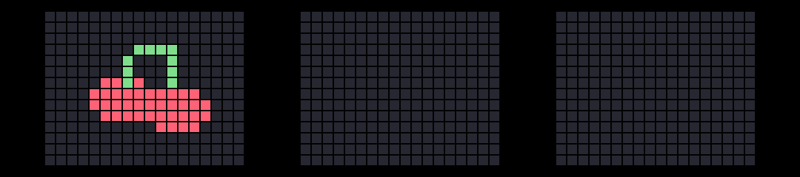
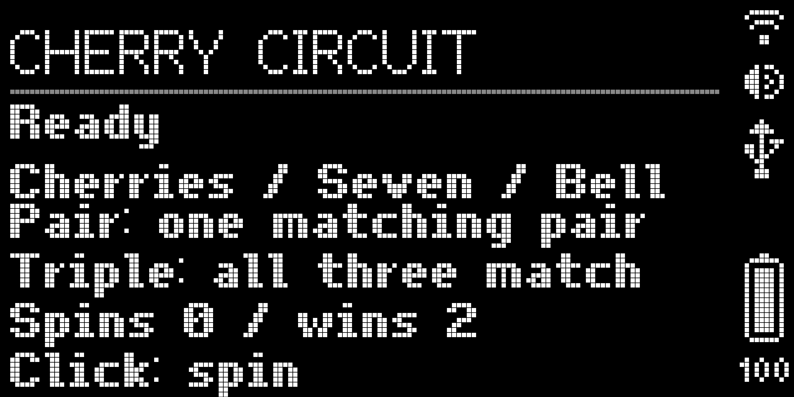
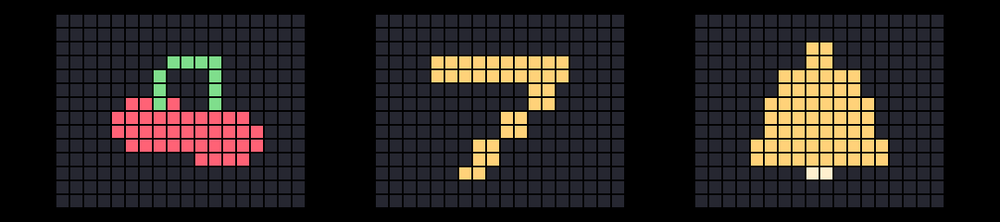
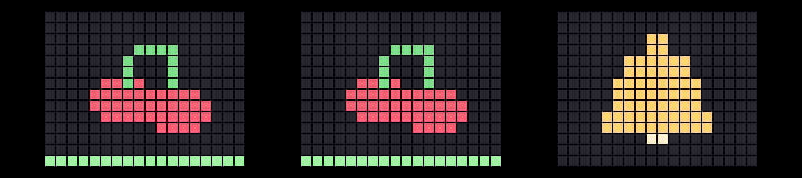

# Cherry Circuit

Spin three reels on the bar. Cherries, sevens, bells, oranges and BAR tiles stop in sequence. A pair counts as a win and three matching symbols make a triple. The rear display keeps the session’s spins and your saved win total.

## Screen transitions

Start a spin and watch the three reels slow and stop in sequence. The symbols stay visible above the lower edge of each window.



<details>

<summary>Watch the rear display</summary>



</details>

## Setup

Open **Cherry Circuit** and press the wheel. No account or network connection is required. Each reel has five equally likely symbols. A round costs nothing and has no payout. Spins during a running round are ignored.

## Spin the three reels

Click once. The left reel stops first, followed by the middle and right reels. Watch the symbols settle along the center line. Read the result on the back.



## Play another round

Press Start after the previous spin finishes. A matching pair or triple marks the reels and increments wins. Three different symbols count as a miss. Play as many rounds as you like. Closing the app resets the session spin count and keeps the win total.



## Run in the emulator

Install BUSY Bar Emulator and open it. From this repository run the following command, then press **Back** when you finish.

```sh
~/.busy-emulator/bin/busy-emulator dev --once
```

The recordings show device controls on emulator firmware. Each LED occupies a 16 × 16 cell with a black border.

[Rear display](screenshots/back-1.png) · [MIT license](LICENSE)
